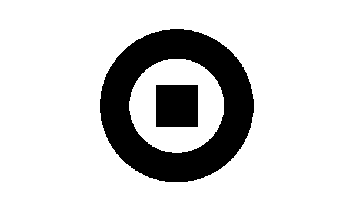
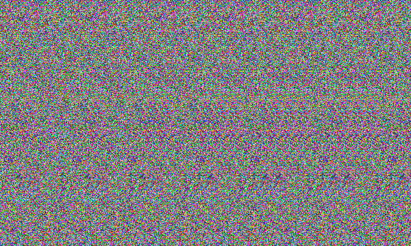

# Stereogram Generator GUI

[](https://github.com/ptxxdxxd/stereogram-generator-gui/actions/workflows/tests.yml)

A small desktop app for making Magic Eye style stereograms. Load a grayscale depth map and any texture image, adjust two sliders, and save a textured autostereogram that hides the depth map's shape in 3D.

Built with Python, Tkinter, NumPy and Pillow.

| Depth map | Stereogram |
| --- | --- |
|  |  |

Both images come from `docs/make_demo.py`, which draws the depth map, uses seeded random dots as the texture and runs the same function the app uses, with the app's default slider values. The tests check the repeat distances that encode depth; nobody has yet confirmed by eye that the ring pops out, so treat that as unverified until you try it.

## How to run

```bash
git clone https://github.com/ptxxdxxd/stereogram-generator-gui.git
cd stereogram-generator-gui
python -m venv venv
venv\Scripts\activate        # Windows
# source venv/bin/activate   # macOS or Linux
pip install -r requirements.txt
python stereogram_gui.py
```

Tkinter ships with most Python installs. On some Linux distributions you need to install it separately (for example `sudo apt install python3-tk`).

## How to use

1. **Select Depth Map.** A grayscale image of a shape, word or object. Black on white works well. It is resized so its longer side is at most 600 pixels. An image that is mostly white is inverted automatically.
2. **Select Texture Image.** Any picture: a cartoon, a photo, an abstract pattern. It is resized to match the depth map.
3. **Adjust the sliders.**
   - *Pattern Width* (30 to 200): how wide each repeating strip of texture is.
   - *Depth Strength* (6 to 40): how far pixels shift, which controls how strongly the shape pops out.
4. **Save Stereogram** writes the full-size result as a PNG.

The preview updates whenever you change an input. To see the hidden shape, relax your eyes and look through the image, or cross your eyes slightly until the 3D shape appears.

## How it works

Each row of the output starts with the first `pattern_width` pixels of the texture. Every pixel after that copies the pixel one pattern width to its left, shifted further left by a depth offset:

```
z = depth_strength * (1 - depth / 255)
```

So darker areas of the depth map get a larger shift. Those small changes in the repeat distance are what your eyes read as depth when the two views fuse. It's classic algorithmic image generation, written as a straightforward per-pixel loop. Pixels that have nothing to copy from keep the texture's own color.

The image functions live in `stereogram_core.py` and the window in `stereogram_gui.py`, so the image code can be tested without a display.

## Tests

```bash
pip install -r requirements.txt pytest
pytest
```

The tests check the output size, that a flat depth map repeats at exactly `pattern_width + z`, that a raised shape shortens the repeat inside it, the depth map's aspect-ratio resize and auto-invert, and a regression test for a bug that left a black band after every pattern strip in far areas. GitHub Actions runs them on Python 3.10 to 3.13 for every pull request. The window itself isn't tested.

## Ideas for later

- Vectorize the inner loop with NumPy for faster previews on large images
- Generate depth maps from text prompts or photos with a depth estimation model
- Ship the demo depth map and a texture as one-click samples in the app

## License

MIT. See [license](license).
